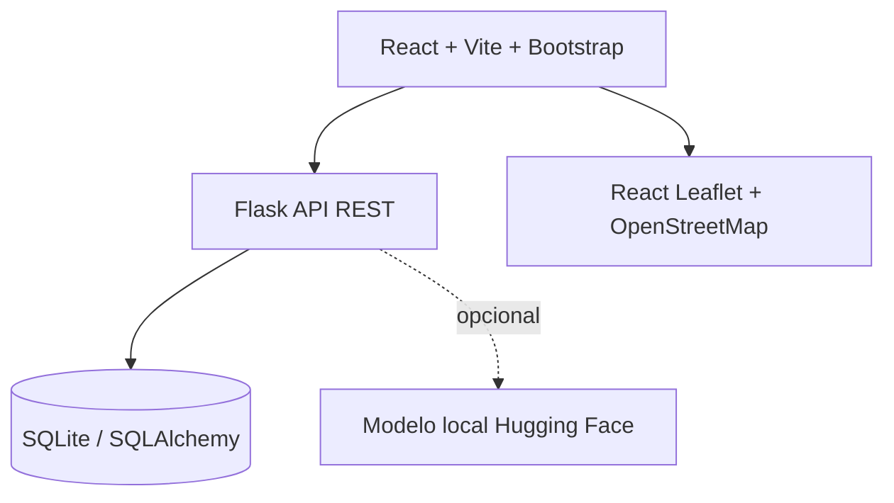

# Arquitectura

## Estructura propuesta
- `frontend/src/pages`: login, registro, formulario, mapa, panel restaurante, panel revisor.
- `frontend/src/components`: navegación, tarjetas, formularios, mapa.
- `backend/app`: rutas, modelos, esquemas, servicios y autorización.

## API inicial (propuesta)
- `POST /api/auth/register` y `POST /api/auth/login`
- `GET/POST /api/donations`; `GET /api/donations/:id`
- `POST /api/donations/:id/requests`
- `GET/POST /api/applications/me`
- `GET /api/reviewer/applications`; `PATCH /api/reviewer/applications/:id`

Definir autenticación mediante cookies seguras HttpOnly o solución equivalente; no almacenar tokens de sesión en localStorage. Validar permisos en cada endpoint. Configurar CORS explícitamente en desarrollo.

## Mapas
Usar teselas OpenStreetMap respetando atribución y política de uso; no exponer domicilios de beneficiarios. Para la demo usar ubicaciones aproximadas.

## IA
Servicio opcional para detectar campos incompletos, normalizar texto y resumir solicitudes. Nunca puntuar merecimiento ni emitir decisiones automáticas. Prever modo sin IA.
