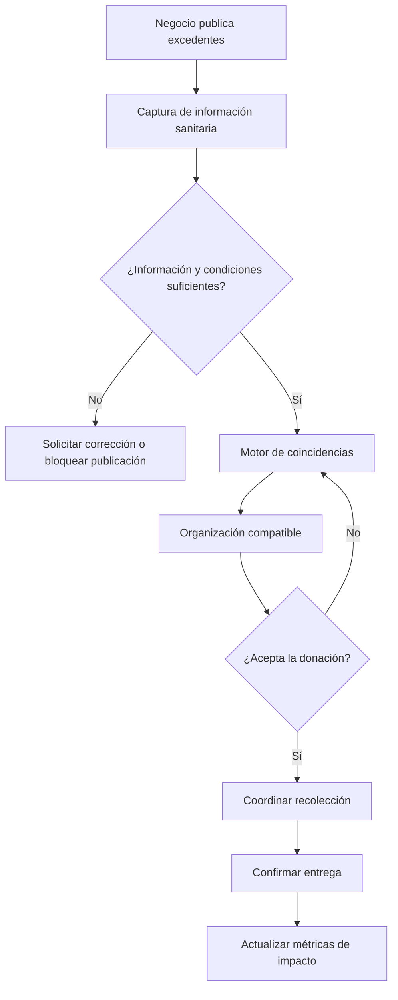
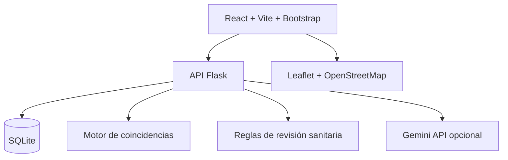
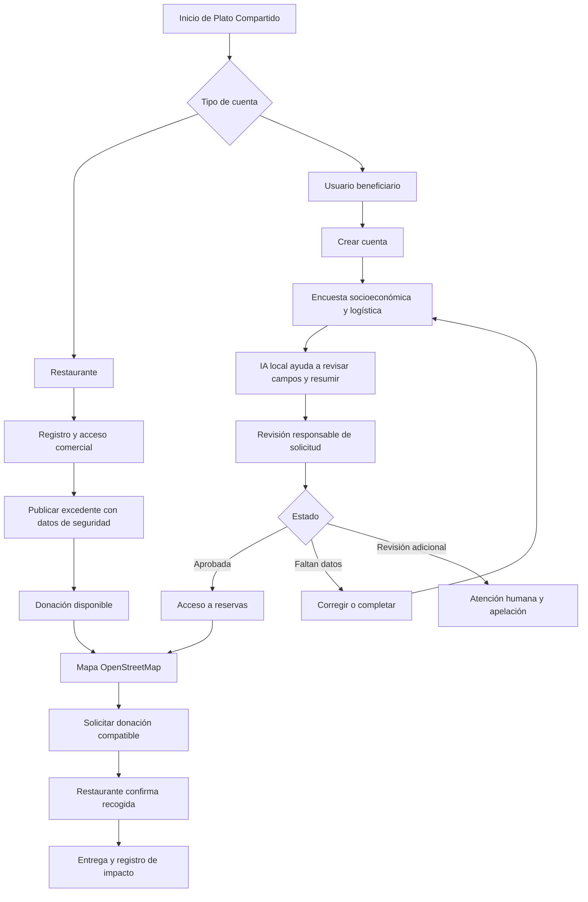

> Documento histórico. Nombre actual: **Nutriendo la Isla**. En caso de contradicción prevalecen AGENTS.md y los demás archivos de docs.

# Plato Compartido

**Lema:** Conectamos alimentos disponibles con comunidades que los necesitan.

**Categoría:** Hack for Humanity Challenge (tercera categoría)

**Tipo de proyecto:** Aplicación web de rescate alimentario con apoyo de inteligencia artificial local y mapas OpenStreetMap.

> **Estado:** Propuesta de prototipo para hackatón. Los ejemplos, organizaciones, distancias y cifras utilizados son ficticios y se presentan únicamente para demostrar el funcionamiento.

## 1. Descripción general

Plato Compartido busca conectar panaderías, restaurantes y comercios que disponen de excedentes alimentarios aprovechables con asociaciones, comedores comunitarios y organizaciones que pueden recibirlos y distribuirlos responsablemente.

La tecnología facilita la publicación de donaciones, la búsqueda de receptores compatibles, la coordinación logística y el seguimiento del impacto. La inteligencia artificial puede ayudar a describir alimentos y explicar las coincidencias recomendadas, sin sustituir las verificaciones de seguridad alimentaria.

## 2. Problema que se busca resolver

Imaginemos una situación en Ciudad del Carmen:

- Una panadería termina el día con 20 panes que no logró vender.
- Un restaurante tiene 10 porciones de comida preparada que no fueron servidas.
- Una asociación comunitaria necesita alimentos para apoyar a familias.
- Los negocios no saben a quién contactar y las organizaciones desconocen qué donaciones están disponibles.

No basta con que existan excedentes. También hay dificultades de comunicación, horarios, transporte, conservación y seguridad sanitaria.

**Pregunta central:** ¿Cómo conectar alimentos aprovechables con organizaciones que puedan recibirlos a tiempo y en condiciones seguras?

## 3. Objetivos

### Objetivo general

Desarrollar un prototipo web que facilite el rescate y la redistribución responsable de excedentes alimentarios mediante herramientas digitales y un motor inteligente de coincidencias.

### Objetivos específicos

1. Permitir a los negocios registrar donaciones de alimentos.
2. Permitir a las organizaciones especificar necesidades, horarios y capacidad de recepción.
3. Recomendar coincidencias según ubicación, disponibilidad y requisitos logísticos.
4. Incorporar un proceso de revisión de información básica sobre seguridad alimentaria.
5. Registrar entregas confirmadas y visualizar métricas de impacto comunitario.

## 4. Usuarios principales

| Rol | Necesidad | Acciones principales |
|---|---|---|
| Negocio donante | Ofrecer excedentes aprovechables | Publicar, actualizar y coordinar donaciones |
| Organización receptora | Recibir alimentos que pueda distribuir | Registrar capacidad, consultar y aceptar donaciones |
| Administrador o moderador | Supervisar el uso del sistema | Revisar publicaciones, incidencias y estadísticas |

**Alcance actualizado:** la aplicación web tendrá dos accesos: restaurantes donantes y usuarios beneficiarios individuales. Las organizaciones comunitarias podrán considerarse en una fase futura. El acceso a las donaciones para beneficiarios requiere validación responsable, sin rechazo automático basado únicamente en IA.

## 5. Flujo de funcionamiento

1. **Publicación:** el negocio sube una fotografía y registra el alimento, la cantidad, su preparación o procedencia, las condiciones de conservación y el horario de recogida.
2. **Revisión de seguridad:** el sistema comprueba que se haya capturado la información requerida. Las publicaciones con datos insuficientes o condiciones incompatibles quedan pendientes o bloqueadas según reglas predefinidas.
3. **Búsqueda de coincidencias:** se comparan las donaciones con organizaciones por distancia, horario, capacidad, tipo de alimento y condiciones de transporte y almacenamiento.
4. **Aceptación:** una organización compatible solicita o acepta la donación.
5. **Coordinación:** ambas partes confirman lugar y hora de entrega.
6. **Cierre:** se registra la entrega efectiva y se actualizan los indicadores de impacto.

## 6. ¿Cómo apoya la tecnología?

### 6.1 Registro inteligente de alimentos

El comerciante puede subir una fotografía. Un modelo multimodal propone una descripción preliminar, por ejemplo: «pan dulce, aproximadamente 15 piezas».

**Importante:** el comerciante debe confirmar o corregir la descripción y proporcionar datos sobre ingredientes, alérgenos, conservación y horario. Una imagen no permite verificar si un alimento es seguro para consumir.

### 6.2 Motor inteligente de coincidencias

El sistema compara:

- Distancia aproximada entre negocio y organización.
- Horarios de recogida y recepción.
- Capacidad de la organización.
- Tipos de alimentos aceptados.
- Necesidad de refrigeración o condiciones especiales de transporte.
- Cantidad disponible y posibilidad de dividir una donación.

Para el prototipo, las coincidencias pueden calcularse con reglas programadas. La IA puede explicar en lenguaje sencillo por qué se recomienda una organización y qué restricciones existen.

### 6.3 Asistente de seguridad alimentaria

Un formulario recopila información sobre:

- Tipo de alimento y preparación.
- Fecha y hora de elaboración, cuando aplique.
- Conservación y condiciones de almacenamiento.
- Requisitos de transporte.
- Ingredientes y alérgenos conocidos.
- Estado del envase y trazabilidad, cuando corresponda.

El sistema señala información faltante y aplica criterios sanitarios previamente definidos. **No debe certificar inocuidad, diagnosticar riesgos ni garantizar que un alimento sea seguro mediante IA.** Las reglas operativas reales requieren validación por responsables capacitados y revisión de la normativa aplicable.

### 6.4 Panel de impacto social

Muestra métricas como:

- Kilogramos de alimentos con entrega confirmada.
- Número de donaciones completadas.
- Número de organizaciones receptoras.
- Tiempo transcurrido entre publicación y aceptación.
- Distribución por tipo de alimento.

Las cifras de la demostración deben estar claramente etiquetadas como simuladas.

## 7. Relación con el área de salud

### 7.1 Salud pública e inocuidad alimentaria

La redistribución debe prevenir riesgos de contaminación y manejo inadecuado. La plataforma puede contribuir solicitando datos sobre conservación, higiene, manipulación y transporte, y evitando que una publicación avance cuando no se cumplen requisitos establecidos.

La Organización Mundial de la Salud resume prácticas básicas en sus cinco claves para la inocuidad de los alimentos: mantener la limpieza; separar alimentos crudos y cocidos; cocinar completamente; mantener los alimentos a temperaturas seguras; y usar agua y materias primas seguras.

Referencia: [OMS — Inocuidad de los alimentos](https://www.who.int/es/news-room/fact-sheets/detail/food-safety).

### 7.2 Nutrición y acceso a alimentos

Las organizaciones pueden especificar los alimentos que necesitan y los que están preparadas para conservar y distribuir. Esto permite priorizar donaciones útiles, incluyendo productos frescos cuando existan condiciones apropiadas.

La plataforma no garantiza una dieta equilibrada ni reemplaza la evaluación nutricional profesional, pero puede facilitar el acceso a recursos alimentarios.

Referencia general: [FAO — Pérdidas y desperdicio de alimentos](https://www.fao.org/food-loss-and-food-waste/es/).

### 7.3 Bienestar comunitario

Una mejor coordinación puede apoyar el trabajo de comedores, albergues y asociaciones que atienden a comunidades con dificultades para acceder a alimentos. El proyecto complementa, pero no sustituye, programas públicos ni servicios especializados.

### 7.4 Colaboración interdisciplinaria

En una etapa posterior, profesionales o estudiantes de Nutrición, Salud Pública y áreas afines podrían ayudar a validar formularios, procedimientos y materiales educativos.

## 8. Ejemplo de demostración

### Donación ficticia

**Negocio:** Panadería La Esperanza (ficticia)

- Alimento: 20 piezas de pan dulce.
- Horario de recogida: 17:00–18:00.
- Estado inicial: pendiente de revisión de información sanitaria.

### Organizaciones ficticias

| Organización | Distancia ilustrativa | Capacidad | Disponible | Resultado logístico |
|---|---:|---:|---|---|
| Comedor Comunitario A | 1.2 km | 30 piezas | Sí | Coincidencia favorable |
| Asociación B | 2.8 km | 10 piezas | Sí | Podría recibir una parte |
| Albergue C | 0.7 km | 25 piezas | No | Horario incompatible |

**Resultado:** el sistema recomienda inicialmente al Comedor Comunitario A porque tiene capacidad suficiente, está disponible y se encuentra relativamente cerca. Antes de concretar la donación, se debe completar la revisión sanitaria y confirmar la logística.

**Qué mostrar al jurado:** publicar la donación, visualizar tres organizaciones, comparar los motivos de compatibilidad, aceptar una coincidencia y registrar una entrega simulada.

## 9. Módulos del MVP

| Módulo | Función | Prioridad |
|---|---|---|
| Donantes | Publicar alimentos con fotografía, cantidad y horarios | Esencial |
| Organizaciones | Registrar necesidades y capacidad de recepción | Esencial |
| Coincidencias | Recomendar receptores compatibles | Esencial |
| Seguridad alimentaria | Formulario y reglas de revisión | Esencial |
| Entregas | Confirmar aceptación y entrega | Esencial |
| Impacto | Panel de estadísticas de rescate | Deseable |
| IA visual | Sugerir descripciones desde fotografías | Opcional |

## 10. Arquitectura tecnológica

| Capa | Tecnología propuesta | Uso |
|---|---|---|
| Aplicación web | React + Vite + Bootstrap | Interfaz para restaurantes y beneficiarios en navegadores de escritorio y móviles |
| Backend | Flask | API de publicaciones, organizaciones y entregas |
| Base de datos | SQLite | Persistencia ligera para el prototipo |
| Mapas | Leaflet + OpenStreetMap | Visualización de ubicaciones |
| IA | Gemini API | Descripciones y explicaciones asistidas |
| Coincidencias | Reglas de negocio en Python | Recomendaciones reproducibles |

**Nota:** la API de IA debe llamarse desde el backend para no exponer claves secretas en el navegador. La plataforma debe continuar operando si la IA no está disponible.

## 11. Modelo de datos mínimo

### Donaciones

- `id`
- `negocio_id`
- `titulo`
- `descripcion`
- `tipo_alimento`
- `cantidad`
- `unidad`
- `fecha_preparacion` (si aplica)
- `condiciones_conservacion`
- `alergenos_declarados`
- `hora_inicio_recoleccion`
- `hora_fin_recoleccion`
- `latitud`, `longitud` (para demostración, ubicaciones ficticias)
- `estado_revision`
- `estado_donacion`

### Organizaciones

- `id`
- `nombre`
- `tipos_aceptados`
- `capacidad_recepcion`
- `horarios`
- `puede_refrigerar`
- `latitud`, `longitud`
- `estado_verificacion`

### Entregas

- `id`
- `donacion_id`
- `organizacion_id`
- `fecha_aceptacion`
- `fecha_entrega`
- `cantidad_confirmada`
- `estado`

## 12. Reglas para recomendar organizaciones

1. Excluir organizaciones no disponibles o sin capacidad suficiente para la cantidad propuesta, salvo que se permita dividir la donación.
2. Excluir organizaciones que no acepten ese tipo de alimento.
3. Verificar compatibilidad de conservación y transporte.
4. Comparar distancias aproximadas y horarios.
5. Ordenar las coincidencias compatibles según criterios transparentes.
6. Mostrar por qué se recomienda cada opción.

**Importante:** el puntaje logístico no es una certificación sanitaria. La donación solo debe avanzar cuando cumpla el proceso de revisión correspondiente.

## 13. Plan de trabajo para un hackatón corto

| Tiempo aproximado | Trabajo |
|---|---|
| 0:00–0:30 | Delimitar problema, definir roles y preparar datos ficticios |
| 0:30–1:30 | Construir interfaz y formulario de donaciones |
| 1:30–2:30 | Implementar API y base de datos |
| 2:30–3:30 | Desarrollar reglas de coincidencia y revisión |
| 3:30–4:30 | Integrar mapa y flujo de aceptación |
| 4:30–5:30 | Agregar panel de impacto y, si hay tiempo, IA |
| 5:30–6:00 | Probar demo, README y presentación |

Si el tiempo es insuficiente, priorizar el flujo completo de **publicar → revisar → recomendar → aceptar → confirmar**, por encima de funciones secundarias.

## 14. Indicadores de impacto

### Indicadores principales

- **Kilogramos rescatados:** peso confirmado de alimentos efectivamente entregados.
- **Donaciones completadas:** número de entregas verificadas.
- **Tiempo de coordinación:** minutos entre publicación y aceptación.

### Indicadores complementarios

- Organizaciones activas.
- Publicaciones sin coincidencia.
- Donaciones rechazadas por información incompleta.
- Distribución de tipos de alimentos.

No convertir automáticamente piezas o kilogramos en «comidas completas» sin un método validado. Tampoco atribuir mejoras sanitarias directas a una lista de verificación.

## 15. Diferenciador: Rescate Inteligente y Seguro

La función central del proyecto responde tres preguntas:

1. ¿Existe información suficiente para considerar la donación dentro del proceso de revisión sanitaria?
2. ¿Qué organización tiene capacidad y condiciones para recibirla?
3. ¿Cómo coordinar la entrega mientras el alimento sigue siendo aprovechable?

La IA apoya el registro y la explicación de coincidencias; las decisiones sanitarias dependen de reglas verificables y responsables capacitados.

## 16. Riesgos y medidas de protección

| Riesgo | Mitigación |
|---|---|
| Publicar alimentos no aptos | Revisión obligatoria y bloqueo ante información insuficiente |
| Falsa confianza en la IA | Mostrar límites y exigir confirmación humana |
| Entrega fuera de horario | Validación de disponibilidad antes de aceptar |
| Falta de refrigeración | Comprobar capacidad de conservación y transporte |
| Organizaciones falsas | Verificación de receptores antes de operar realmente |
| Datos personales expuestos | Recopilar lo mínimo necesario y limitar el acceso |
| Resultados exagerados | Separar datos simulados de entregas reales |

Antes de desplegar el sistema para donaciones reales, es indispensable consultar requisitos legales y sanitarios aplicables en México y Campeche, así como establecer responsabilidades claras de donantes, transportistas y receptores.

## 17. Pitch de presentación

> Cada día, negocios pueden terminar su jornada con alimentos que no vendieron, mientras organizaciones comunitarias necesitan recursos para apoyar a otras personas.
>
> Creamos **Plato Compartido**, una plataforma que conecta a comercios con organizaciones receptoras, utilizando inteligencia artificial para facilitar el registro de alimentos y recomendar coincidencias según ubicación, horario y capacidad.
>
> Además, incorporamos verificaciones de seguridad alimentaria porque rescatar alimentos no basta: también importa que su distribución sea responsable.
>
> Nuestra propuesta busca convertir excedentes aprovechables en oportunidades de apoyo comunitario.

### Guion de demostración de cinco minutos

1. **0:00–0:45 — Problema:** explicar la desconexión entre excedentes y organizaciones.
2. **0:45–1:30 — Solución:** mostrar el flujo general y a quién beneficia.
3. **1:30–3:30 — Demo:** publicar 20 panes, revisar información, mostrar coincidencias y aceptar una entrega simulada.
4. **3:30–4:15 — Salud e impacto:** explicar controles sanitarios y métricas.
5. **4:15–5:00 — Cierre:** destacar el potencial comunitario y las siguientes etapas.

## 18. Evolución futura

- Validación de organizaciones receptoras reales.
- Protocolos sanitarios desarrollados con especialistas.
- Notificaciones de nuevas donaciones compatibles.
- Coordinación con transportistas o voluntariado autorizado.
- Historial y trazabilidad de entregas.
- Reportes de impacto por zona y tipo de alimento.
- Accesibilidad y soporte para dispositivos de bajo costo.

## 19. Decisiones pendientes (revisadas)

- **Decidido:** la primera versión web tendrá restaurantes y beneficiarios individuales como dos roles de acceso.
- ¿Qué categorías de alimentos se permitirán en un piloto real?
- ¿Quién validará las condiciones sanitarias y la identidad de los receptores?
- ¿Qué información se compartirá públicamente y cuál será privada?
- ¿Qué parte de la IA se implementará durante el hackatón y cuál quedará como evolución futura?

**Recomendación actualizada:** comenzar con panadería y productos envasados cuya conservación y trazabilidad puedan documentarse. Para el hackatón, utilizar perfiles y solicitudes ficticias, simular la validación de beneficiarios y demostrar el flujo sin distribuir alimentos reales.

---

**Resumen ejecutivo actualizado:** Plato Compartido será una aplicación web con dos roles —restaurantes y beneficiarios—, mapas OpenStreetMap y un registro de beneficiarios mediante formulario socioeconómico. Un componente local de IA podrá ayudar a revisar la integridad de las solicitudes, pero no determinará por sí solo el acceso a alimentos. El proyecto combinará rescate alimentario, privacidad, seguridad sanitaria y coordinación logística.

---

## 20. Actualización de alcance: aplicación web

**Decisión de producto:** Plato Compartido se desarrollará inicialmente como **aplicación web responsiva**, accesible desde navegadores en computadoras, tabletas y teléfonos. No se requiere instalar una app nativa.

- **Framework recomendado:** React + Vite + Bootstrap para desarrollar una aplicación web responsiva.
- **Mapas:** OpenStreetMap (OSM) como fuente cartográfica, mediante React Leaflet y un proveedor de teselas que permita el volumen de uso. OSM aporta datos; no debe asumirse que sus servidores públicos de teselas admiten uso ilimitado. Se respetarán las políticas de uso y atribución.
- **Backend:** Flask con SQLite durante el prototipo; en producción, migrar a una base de datos y servicio de autenticación más robustos.
- **IA económica:** prototipo local con modelos de Hugging Face, o un servicio de bajo costo si el dispositivo o servidor no tiene capacidad suficiente. Se debe verificar la licencia y el consumo de recursos del modelo.
- **Notificaciones:** avisos dentro de la web; las notificaciones push pueden quedar para una fase posterior.

### 20.1 Dos roles y dos accesos

| Rol | Registro e inicio de sesión | Funciones tras iniciar sesión |
|---|---|---|
| Restaurante / negocio donante | Formulario comercial, datos de contacto y verificación básica del establecimiento | Publicar excedentes, indicar cantidades y horario, gestionar solicitudes y confirmar entregas |
| Usuario beneficiario | Formulario personal mínimo + encuesta voluntaria de situación socioeconómica + revisión de solicitud | Consultar donaciones, ver puntos de recogida aproximados, solicitar reservas y confirmar recepción |

**Importante:** son dos experiencias de registro/inicio de sesión, pero pueden compartir el mismo sistema de autenticación y una columna `rol` en la base de datos. El registro no equivale a la aprobación para solicitar donaciones.

### 20.2 Estados de una cuenta beneficiaria

1. `registro_iniciado`: la persona crea su cuenta.
2. `solicitud_incompleta`: faltan datos esenciales; puede completarlos después.
3. `pendiente_revision`: el formulario se envió correctamente.
4. `informacion_adicional`: se solicita una aclaración concreta sin cancelar la cuenta.
5. `aprobada`: puede reservar donaciones.
6. `revision_adicional`: requiere intervención de una persona responsable, con oportunidad de corregir o apelar.

No se debe impedir el acceso a información sobre apoyo alimentario ni a los canales de atención por no aprobar una evaluación automatizada. Si en el futuro existe una decisión desfavorable, debe contar con explicación, revisión humana y apelación.

## 21. Encuesta inicial para usuarios beneficiarios

**Objetivo:** conocer necesidades logísticas y circunstancias relevantes para orientar la atención, sin exigir detalles íntimos innecesarios ni convertir la encuesta en una prueba de merecimiento.

### 21.1 Preguntas propuestas

| Campo | Ejemplo de pregunta | Uso |
|---|---|---|
| Zona general | ¿En qué colonia o zona puedes recoger alimentos? | Mostrar opciones cercanas sin solicitar domicilio exacto |
| Tamaño del hogar | ¿Para cuántas personas buscas apoyo? | Orientar cantidades de entrega |
| Frecuencia de necesidad | ¿Con qué frecuencia te vendría bien recibir apoyo alimentario? | Planear disponibilidad y distribución |
| Disponibilidad | ¿En qué horarios puedes recoger una donación? | Coincidencias logísticas |
| Transporte | ¿Puedes desplazarte al punto de entrega? | Elegir puntos accesibles |
| Conservación | ¿Tienes refrigeración para conservar alimentos que la requieran? | Evitar asignaciones inadecuadas |
| Restricciones alimentarias | ¿Hay algún alimento que debamos evitar? (opcional) | Mejorar compatibilidad y seguridad |
| Situación económica | ¿Deseas describir brevemente tu situación o solicitar una revisión confidencial? (opcional) | Contexto para personal autorizado, nunca clasificación automática de merecimiento |

Evitar pedir CURP, identificación oficial, comprobantes de ingresos, fotografías del hogar, diagnósticos médicos o geolocalización permanente durante el MVP. Si posteriormente se requiere verificación documental, deberá existir una justificación clara, un aviso de privacidad y alternativas accesibles.

### 21.2 Uso responsable de IA local de Hugging Face

**Función permitida y recomendable para el MVP:** asistir en el procesamiento administrativo del formulario, no decidir automáticamente si una persona merece comida.

- Detectar respuestas vacías y solicitar aclaraciones de forma amable.
- Extraer información logística de texto libre, con confirmación del usuario.
- Clasificar preferencias de recogida y compatibilidad de alimentos.
- Generar un resumen neutral para revisión humana, evitando inferencias sobre pobreza, honestidad o identidad.
- Explicar el estado de la solicitud y qué paso sigue.

**No implementar:** puntuación automática de pobreza, predicción de si alguien “realmente necesita” alimentos, detección de mentiras, reconocimiento facial para juzgar elegibilidad, ni denegación automática de acceso basada en características personales. Son decisiones de alto impacto con riesgos de sesgo y errores.

**Opciones técnicas:**

1. **Reglas deterministas + modelo pequeño local:** mejor opción para un hackatón. Las reglas comprueban campos y requisitos publicados; el modelo solo interpreta texto libre y genera resúmenes.
2. **Hugging Face Transformers en un backend Python local:** permite probar un modelo multilingüe pequeño; medir memoria, latencia y calidad en español antes de integrarlo.
3. **API de inferencia de bajo costo:** alternativa si el modelo local no funciona con el hardware disponible; evaluar precio, límites, tratamiento de datos y condiciones de privacidad antes de enviar información real.

No es necesario entrenar un modelo propio para la primera versión. **En la demostración, utilizar exclusivamente perfiles ficticios y respuestas simuladas.**

### 21.3 Revisión humana y acceso justo

- Publicar criterios claros de participación, acordados con organizaciones sociales y responsables del programa.
- Separar **registro de cuenta**, **revisión de solicitud** y **permiso para reservar alimentos**.
- Permitir corregir respuestas y solicitar revisión de una decisión.
- No penalizar por falta de documentos, mala redacción, discapacidad, idioma o acceso limitado a internet.
- Si las donaciones son escasas, utilizar reglas transparentes de distribución y límites por periodo, con supervisión humana.
- Mantener visible un directorio de recursos comunitarios para cualquier persona, incluso con solicitud pendiente.

## 22. Flujo web completo

## 23. Pantallas recomendadas

### Para restaurantes

1. Bienvenida y selección de rol.
2. Registro/inicio de sesión del negocio.
3. Inicio con donaciones activas y completadas.
4. Crear donación: fotografía, tipo, cantidad, conservación, alérgenos, hora límite y punto de entrega.
5. Solicitudes recibidas y confirmación de entrega.

### Para beneficiarios

1. Bienvenida y selección de rol.
2. Registro/inicio de sesión.
3. Encuesta inicial y estado de revisión.
4. Inicio con mapa OpenStreetMap y lista de donaciones cercanas.
5. Ficha de donación: cantidad, alérgenos, condiciones y horario.
6. Solicitud/reserva y confirmación de recogida.
7. Perfil, privacidad y opción para corregir datos o solicitar revisión.

**Privacidad geográfica:** el mapa puede mostrar zonas generales antes de reservar; la dirección exacta de recogida se revela solo cuando sea necesario. No publicar la ubicación del hogar del beneficiario.

## 24. Modelo de datos adicional

| Entidad | Campos mínimos |
|---|---|
| `usuarios` | `id`, `email`, `password_hash` o `auth_provider_id`, `rol`, `estado_cuenta`, `creado_en` |
| `restaurantes` | `id`, `usuario_id`, `nombre_comercial`, `contacto`, `zona`, `ubicacion_entrega` |
| `solicitudes_beneficiario` | `id`, `usuario_id`, `estado`, `fecha_envio`, `fecha_revision`, `motivo_visible`, `revisor_id` |
| `respuestas_encuesta` | `solicitud_id`, `zona_general`, `tamano_hogar`, `frecuencia`, `horarios`, `transporte`, `refrigeracion`, `restricciones_opcionales` |
| `donaciones` | `id`, `restaurante_id`, `descripcion`, `cantidad`, `unidad`, `alergenos`, `conservacion`, `horario_limite`, `estado` |
| `reservas` | `id`, `donacion_id`, `beneficiario_id`, `cantidad`, `estado`, `fecha` |
| `revisiones` | `id`, `solicitud_id`, `revisor_id`, `accion`, `justificacion`, `fecha` |

La encuesta y cualquier texto libre sensible deben almacenarse con controles de acceso estrictos, periodos de conservación limitados y posibilidad de corrección o eliminación cuando corresponda. Nunca guardar contraseñas en texto plano. La revisión administrativa no constituye un tercer tipo de cuenta pública, sino una función interna protegida.

## 25. MVP actualizado para el hackatón

**Imprescindible:**

1. Aplicación web responsiva con React + Vite + Bootstrap y selección de rol.
2. Registro e inicio de sesión demostrativos para restaurantes y beneficiarios.
3. Encuesta inicial con validación de campos y estado de solicitud.
4. Resumen de encuesta generado con reglas o un modelo local pequeño, usando datos ficticios.
5. Revisión simulada y habilitación de reservas para un usuario aprobado.
6. Restaurante publica una donación ficticia.
7. Mapa con OpenStreetMap y una donación cercana.
8. Usuario reserva; restaurante confirma la entrega.

**Dejar para una segunda fase:** entrenamiento personalizado de modelos, verificación documental, pagos, mensajería, geolocalización en tiempo real, sistema de reputación y despliegue con usuarios reales.

### Guion de demo de 3–5 minutos

1. Restaurante ficticio entra y publica 15 panes con horario y condiciones de conservación.
2. Beneficiario ficticio crea su cuenta y responde la encuesta.
3. La IA local detecta un dato faltante, solicita completarlo y produce un resumen neutral.
4. Una revisión humana simulada aprueba la solicitud; el usuario ya puede reservar.
5. El mapa OpenStreetMap muestra la donación; el usuario la solicita.
6. El restaurante confirma la entrega y el panel registra una donación completada.

**Mensaje clave al jurado:** la innovación no consiste en que una IA decida quién merece comer; consiste en usar tecnología asequible para conectar excedentes con personas que requieren apoyo, reducir fricción administrativa y organizar entregas de manera segura y digna.

## 26. Pendientes de validación antes de un piloto real

- Acordar con una organización social los criterios de participación y el proceso de apelación.
- Consultar los requisitos legales y sanitarios mexicanos aplicables a la donación, manipulación y entrega de alimentos.
- Revisar aviso de privacidad, consentimiento, medidas de seguridad y tratamiento de información socioeconómica conforme a la legislación aplicable.
- Definir cómo se verificará a los restaurantes y quién será responsable de aprobar las donaciones.
- Elegir el modelo local concreto después de probar precisión en español, latencia, memoria y licencia.
- Definir qué ocurrirá cuando no haya suficientes alimentos para todas las solicitudes.
- Comprobar políticas de teselas, geocodificación y atribución de OpenStreetMap antes del despliegue.
